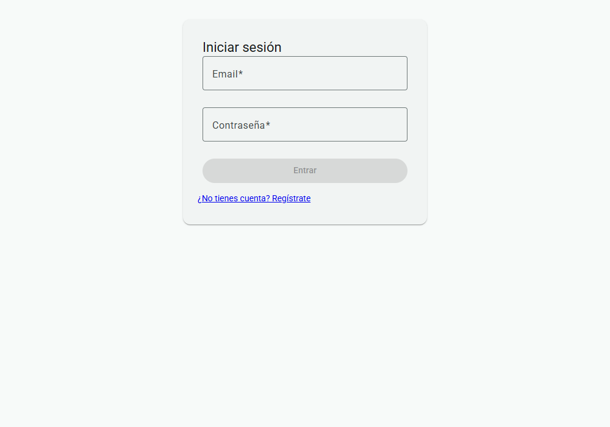
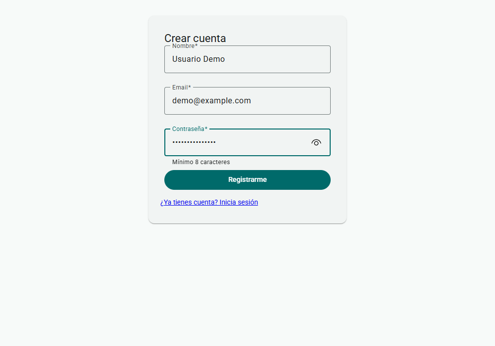
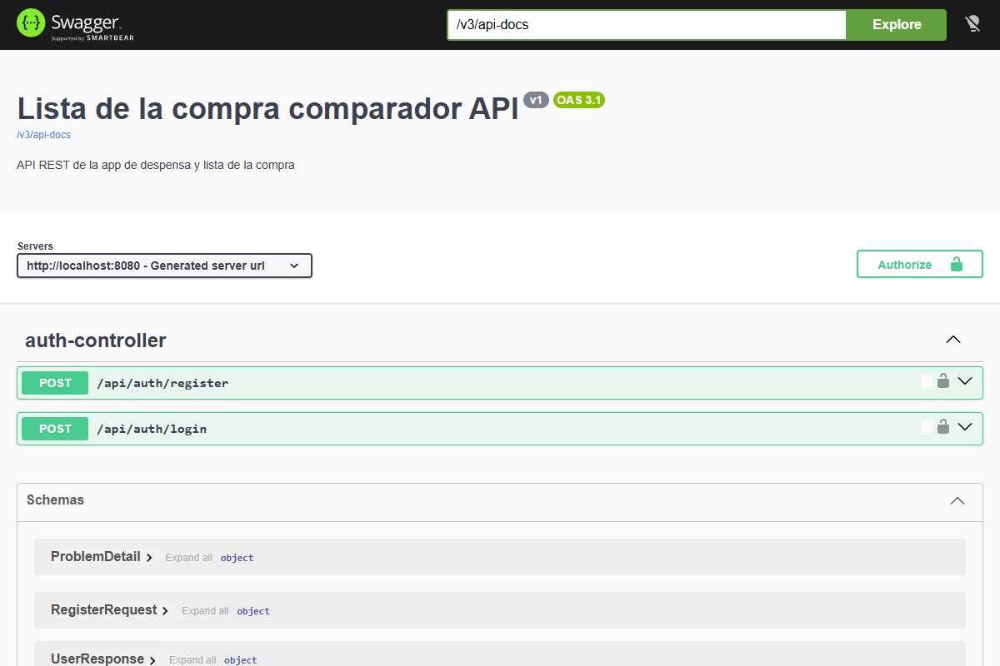

# Lista de la compra comparador

App web para llevar la **despensa** y la **lista de la compra** de casa, y comparar productos
de supermercado por **precio, ingredientes y cantidad del envase** (pack de 12, por kg, por litro...).

La app no compra nada online: solo planifica. La compra se hace en la tienda.

> **Estado: en desarrollo.** La autenticación, los productos y la despensa están terminados de
> punta a punta (API y pantallas en Angular); el aviso de stock bajo y la compra son lo siguiente.

## Qué hay hecho y qué falta

- [x] Modelo de datos, requisitos y arquitectura documentados ([`docs/`](docs/))
- [x] PostgreSQL en Docker Compose y migraciones con Flyway
- [x] Registro de usuarios (`POST /api/auth/register`) con contraseñas cifradas con BCrypt
- [x] Login con JWT (`POST /api/auth/login`) y API protegida con Spring Security
- [x] Tests unitarios de `UserService` y `JwtService` (JUnit 5 + Mockito)
- [x] Documentación de la API con Swagger/OpenAPI, con botón *Authorize* para el JWT
- [x] Frontend Angular: login, registro, interceptor que envía el JWT y guard de rutas
- [x] Productos manuales, privados por usuario (`/api/products`: crear, listar, ver, editar y borrar; ver otro usuario devuelve 404)
- [x] Frontend Angular de productos: listar, crear, editar y borrar (`/productos`)
- [x] Despensa (`/api/pantry`): añadir (suma si el producto ya está), listar, cambiar la cantidad y quitar; privada por usuario
- [x] Frontend Angular de la despensa (`/despensa`)
- [x] Stock bajo en la API (`GET /api/pantry/low-stock`), con umbral propio de cada usuario
- [ ] Aviso de stock bajo en el frontend
- [ ] Consumo programado
- [ ] Compra: lista por defecto, listas con nombre y total estimado
- [ ] Búsqueda de productos de Mercadona
- [ ] Historial de compras y estadísticas de gasto
- [ ] Lista de la compra en PDF

El plan completo por fases está en [`docs/REQUISITOS.md`](docs/REQUISITOS.md).

## Capturas

| Login | Registro |
|-------|----------|
|  |  |

Documentación de la API con Swagger UI:



## Stack

| Capa | Tecnología |
|------|------------|
| Backend | Java 21, Spring Boot 4, Spring Web, Spring Data JPA |
| Seguridad | Spring Security, JWT, BCrypt |
| Base de datos | PostgreSQL 16, Flyway |
| Frontend | Angular 22, Angular Material, TypeScript |
| Documentación API | springdoc-openapi (Swagger UI) |
| Infraestructura | Docker Compose |
| Tests | JUnit 5, Mockito, AssertJ (backend) · Angular TestBed (frontend) |

## Cómo arrancarlo

### Requisitos

- Docker (con Docker Compose)
- JDK 21
- Node.js y npm (el proyecto usa npm 11)

### 1. Variables de entorno

Copia el fichero de ejemplo y cambia los valores:

```bash
cp .env.example .env
```

`.env` está en `.gitignore`: nunca se sube a Git. `JWT_SECRET` debe ser una cadena aleatoria
de 32 caracteres o más.

### 2. Base de datos

Desde la raíz del repo:

```bash
docker compose up -d
```

Levanta PostgreSQL en el puerto **5435** del PC (el 5432 queda libre para otras instalaciones).
Los datos se guardan en un volumen, así que sobreviven aunque se borre el contenedor.

### 3. Backend

El backend lee la conexión a la base de datos de tres variables de entorno: `DB_USER` y
`DB_PASSWORD` (con los mismos valores que `POSTGRES_USER` y `POSTGRES_PASSWORD` del `.env`)
y `JWT_SECRET`. Spring Boot **no** lee el fichero `.env` por sí solo, así que hay que
definirlas en la terminal antes de arrancar.

En PowerShell:

```powershell
cd backend
$env:DB_USER = "listacompracomparador"
$env:DB_PASSWORD = "el_mismo_valor_que_POSTGRES_PASSWORD"
$env:JWT_SECRET = "el_mismo_valor_que_JWT_SECRET_del_env"
.\mvnw.cmd spring-boot:run
```

En Linux, macOS o Git Bash:

```bash
cd backend
export DB_USER=listacompracomparador
export DB_PASSWORD=el_mismo_valor_que_POSTGRES_PASSWORD
export JWT_SECRET=el_mismo_valor_que_JWT_SECRET_del_env
./mvnw spring-boot:run
```

Al arrancar, Flyway crea las tablas. La API queda en <http://localhost:8080>.

### 4. Frontend

```bash
cd frontend
npm install
npm start
```

La app queda en <http://localhost:4200>. El servidor de desarrollo reenvía las llamadas
`/api` al backend (ver [`frontend/proxy.conf.json`](frontend/proxy.conf.json)), así que no
hay problemas de CORS.

### 5. Documentación de la API (Swagger)

Con el backend en marcha: <http://localhost:8080/swagger-ui/index.html>

Para probar los endpoints protegidos, haz login desde Swagger, copia el token y pulsa
*Authorize*.

## Tests

```bash
# Backend
cd backend
./mvnw test

# Frontend
cd frontend
npm test
```

## Estructura del repositorio

```
backend/    API REST (Spring Boot)
  core/       entidades, repositorios y servicios
  web/        controladores y DTOs
  security/   JWT y configuración de Spring Security
  config/     configuración (Swagger, BCrypt)
frontend/   SPA (Angular)
docs/       qué hace la app y cómo está diseñada
apuntes/    cómo funcionan las herramientas que uso para construirla
docker-compose.yml
```

## Documentación

- [`docs/FUNCIONALIDADES.md`](docs/FUNCIONALIDADES.md): qué hace cada apartado
- [`docs/REQUISITOS.md`](docs/REQUISITOS.md): requisitos, reglas de negocio y fases
- [`docs/ARQUITECTURA.md`](docs/ARQUITECTURA.md): modelo de datos e integraciones con supermercados
- [`docs/SESIONES.md`](docs/SESIONES.md): diario de decisiones
- [`apuntes/`](apuntes/00-indice.md): apuntes de aprendizaje (Spring, JPA, JWT, tests...)

## Cómo trabajo

Cada funcionalidad va en una rama `feature/...`, con commits pequeños y un Pull Request
hacia `main`. El flujo está explicado en [`apuntes/02-git-flujo.md`](apuntes/02-git-flujo.md).

## Cómo está hecho

Es un proyecto personal de aprendizaje y lo desarrollo **con ayuda de IA (Claude) como
herramienta**. Algunos commits llevan a Claude como coautor. Las decisiones del proyecto
están documentadas en [`docs/SESIONES.md`](docs/SESIONES.md), el código se revisa y se prueba
(tests automáticos y pruebas manuales de punta a punta) y en [`apuntes/`](apuntes/00-indice.md)
dejo escrito lo que voy entendiendo de cada parte.
